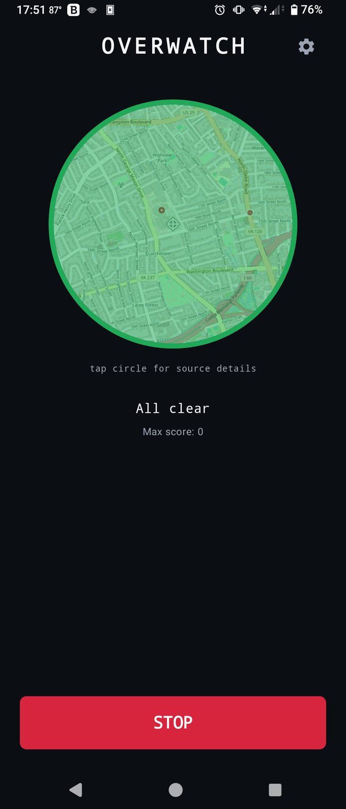
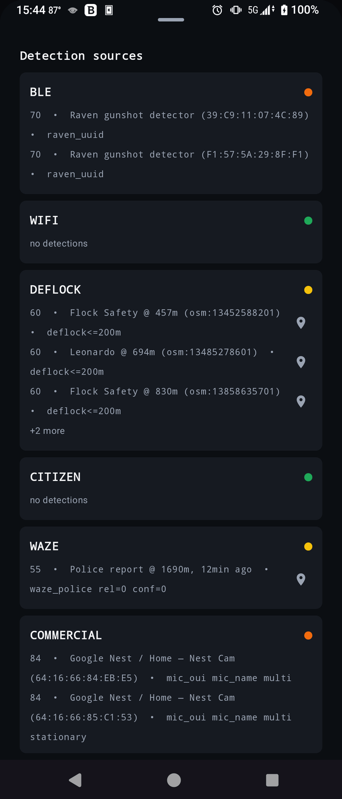
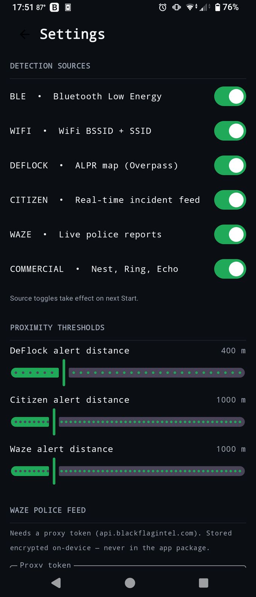

# OVERWATCH

A native Android (Kotlin) **surveillance-detection** app. Open it, hit
**START**, and a circle turns **green / yellow / orange / red** depending on
how confident the engine is that there's a Flock Safety ALPR, an Axon body
camera, or active police presence near you. With the screen locked, the
foreground notification updates with the current tier and the phone vibrates
on upward escalations — you don't have to be looking at the screen. With the
screen off, Android allows only filtered Bluetooth scans, so MAC-prefix and name
matches (Axon among them) wait until it wakes; Raven, Flock's maker ID and the
online sources carry on.

> **Defensive only.** OVERWATCH never connects to, pairs with, or jams anything
> it detects. Its radio scans are the ordinary ones every Android phone makes —
> Wi-Fi scanning sends probe requests, Bluetooth scanning sends scan requests —
> and the online sources have to say where to look: each is told the centre of
> the 1 km grid square you are in (the camera map, its ~5.5 km cell), never your
> position itself, and the map's tiles come from OpenStreetMap. A row's map pin,
> when you tap it, opens Google Maps at that detection (see
> [SOURCES.md §5.4](SOURCES.md)). The Axon advertise/fuzz code from one of
> the reference projects is intentionally excluded.

Website: **[overwatch.netslum.io](https://overwatch.netslum.io)**  ·  Latest release: [v0.5.19](https://github.com/KaraZajac/OVERWATCH/releases) (debug-signed APK, sideload).

---

## Screenshots

<p align="center">
  
  &nbsp;&nbsp;
  
  &nbsp;&nbsp;
  
</p>

<p align="center"><sub>Live threat-map circle · source drill-down · settings — taken on v0.5.5 or earlier, so they still show the retired Citizen source and Waze proxy-token field, and no Aircraft source; new screenshots are coming.</sub></p>

---

## What it detects

| Source | What it looks at | Where it comes from |
|---|---|---|
| **BLE** | Bluetooth-LE advertisements: MAC OUI prefixes (Axon's own, and the radio-module makers' prefixes seen on Flock Penguin / Raven hardware, none of them registered to Flock), XUNTONG mfg id `0x09C8`, "TN" serial pattern, Raven service UUIDs, device-name patterns — plus 19 IEEE-verified surveillance-vendor OUIs (Flock Safety's own `b4:1e:52`, ShotSpotter, WatchGuard/Motorola, Verkada, Avigilon Alta, Axis body cams, FLIR, Hanwha, March Networks, GeoVision, Mobotix, Sunell) with vendor-named labels | Local radio scan (BLE callback API). Iterates every manufacturer-specific data entry to find XUNTONG (then any COMMERCIAL company id), not just the first. **Screen off:** Android suspends unfiltered scans, so the scanner switches to a filtered scan (Raven UUIDs, XUNTONG, the Echo and HeyCyan service UUIDs and the glasses company ids — 16 filters at most, so Amazon, Google and Sonos drop out); OUI-prefix and name matching resume when the screen is on — see [SOURCES.md §5.1](SOURCES.md). Police-exclusive OUIs (WatchGuard, ShotSpotter) score ORANGE on sight, same rationale as Axon. |
| **WiFi** | BSSID prefixes seen on Flock hardware (flock-you's list of 31, all radio-module makers' prefixes, none registered to Flock) + the same 19 vendor OUIs, Flock Safety's own among them (WatchGuard 4RE in-car APs, Openpath/Alta readers, WiFi-capable cameras), `Flock-XXXX` and other generic SSID patterns | `WifiManager.getScanResults()` polled every 35 s (just under the Android 9+ 4-scans/2-min throttle) |
| **DEFLOCK** | Mapped ALPRs, speed cameras and other surveillance cameras within 1.2 km, each scored on its own curve by how close it actually is | POST to Overpass API (`overpass.deflock.org` → fallback `overpass-api.de`) for every `man_made=surveillance` node plus `highway=speed_camera`, in a box ±0.05° around the centre of your 0.05° grid cell (never around your position), so Overpass learns only which ~5.5 km cell you are in; cached per cell for the current scan only, and deleted when scanning stops. Fetches the next cell as soon as your 1.2 km circle would reach past the loaded box, so every position is checked against a box that covers it (below about 64° latitude), and retries a failed fetch after 60 s. Treats `{"remark": "...timed out..."}` 200-responses as failure so timeouts don't poison the cache. |
| **WAZE** | User-reported `POLICE` alerts still active in the feed within 2 km, up to ~45 min old, scored by distance and age | **Two selectable backends.** *OpenWeb Ninja* (default): `api.openwebninja.com/waze/alerts-and-jams` called with **your own API key** (`X-API-Key`, entered in Settings, stored encrypted on-device), polled every ~4 min with `alert_types=POLICE&max_jams=0` (~1.5 KB/poll). Metered, lags live Waze by ~20 min, and Waze never sees you — the request is made by OpenWeb Ninja's servers, which are told the centre of your 1 km grid square, under your key. *Direct* (opt-in, off by default): speaks the Waze app's own protocol over an anonymous account OVERWATCH registers, polled every 60 s. Free, keyless and live, but it reports which 1 km grid square you are in to a Google service on every poll. Waze never gets the exact fix. Both re-filter to POLICE client-side so an upstream change can't let other types through. Alerts carry crowd-trust signals that nudge the score up. |
| **AIRCRAFT** | Police / surveillance aircraft overhead — identified from a bundled registry of 1,971 law-enforcement airframes, all but 36 of them American, plus loiter detection for unlisted ones | `opendata.adsb.fi` → fallback `api.adsb.lol`, polled every 60 s and told the centre of your 1 km grid square, not your position. **No API key.** Community ADS-B networks are used specifically because the commercial trackers filter law-enforcement flights at government request. Matched on the ICAO 24-bit address; scored by ground distance, altitude and orbit behaviour. |
| **COMMERCIAL** | Nearby consumer smart-home / voice gear (Nest, Ring, Echo, Sonos, hidden cams) and camera-bearing smart glasses (Meta Ray-Ban / Oakley, Snap Spectacles, Vuzix, and HeyCyan-SDK frames such as the Nilox Smart AI Glasses) as a secondary situational signal | Rides the BLE + WiFi scans — OUI / device-name / service-UUID / SSID matches plus Bluetooth SIG company IDs from `MicTargets`. Score-capped at ORANGE so a cluster of doorbells (or a passing pair of Ray-Bans) never reads as ALPR-grade certainty. |

> **Citizen was removed (v0.5.8).** Citizen ended the police-dispatch data
> partnership behind its public feed in June 2026. It first degraded to silent
> empty stubs, and as of **2026-09-16** `citizen.com/api/incident/trending`
> returns **HTTP 410 Gone — `{"error":"This endpoint has been removed."}`**,
> which is upstream formally tombstoning it. `data.sp0n.io` (the host the
> current web app uses) answers 200 with a zero-byte body even with no query
> params. Structured incident data is now Citizen's paid Enterprise API only,
> which needs a business use-case application — not something this app can
> ship. The source and all its code were therefore deleted rather than left
> as a permanently-failing row. Police presence is still covered by Waze
> (denser for roadway stops anyway) and DeFlock.

> **Waze: pick a backend (v0.5.15+).** The public `live-map/api/georss` endpoint every scraper used is dead: it sits behind Google's edge, which returns **HTTP 403** to automated clients regardless of IP, headers, TLS fingerprint, or headless-vs-headful browser — Waze's own page requests included. That is why v0.1.5 removed the original integration. OVERWATCH now offers two ways in, and the choice is a genuine trade rather than one being better. **OpenWeb Ninja** (the default) reads a hosted Waze feed with a key you supply yourself; it costs a few dollars a month and lags ~20 min, and the request comes from their servers, so Waze learns nothing about you — OpenWeb Ninja itself learns your 1 km grid square every 4 minutes, under your key. **Direct** speaks the Waze app's own protocol — free, keyless, live — but OVERWATCH then holds an anonymous Waze account and tells Waze which 1 km grid square you are in on every poll. That is never the exact fix, but one account reporting squares is still a coarse track a Google service can follow. It is off unless you turn it on. See [Waze setup](#waze-setup-choosing-a-backend). Nothing is baked into the APK either way. The Waze for Cities partner feed was ruled out — it excludes POLICE and is agency-only.

> **Full reference:** [SOURCES.md](SOURCES.md) documents every endpoint, every
> BLE/WiFi identifier, the scoring tables, and the sources that were tried and
> rejected (and why).

Every observation is scored 0–100 by `ConfidenceEngine`. The on-screen tier is
the maximum live score across all sources:

```
GREEN      < 40    nothing credible
YELLOW   40 – 69   single weak indicator
ORANGE   70 – 84   high confidence
RED        85 +    certain
```

**DeFlock and Waze are scored on a sliding scale, not a flat value.** Both
carry real coordinates, so the score is a continuous falloff over the actual
distance — drive toward a camera and the number climbs, drive past and it
drops. The anchors are absolute metres and deliberately independent of the
detection-radius setting: a camera 200 m away is equally close whether the
slider reads 300 m or 5 km, so moving a setting must never move the threat
level. A Waze report additionally decays by up to 12 points across its 45-min
freshness window, because police move and a surveyed camera does not.

| Distance | DeFlock ALPR | Waze police (fresh) |
|---|---|---|
| 0 m | 95 RED | 80 ORANGE |
| 50 m | 85 RED | 75 ORANGE |
| 100 m | 72 ORANGE | 70 ORANGE |
| 200 m | 55 YELLOW | 63 YELLOW |
| 350 m | 42 YELLOW | 53 YELLOW |
| 500 m | 35 GREEN | 48 YELLOW |
| 1000 m | 26 GREEN | 35 GREEN |
| 3000 m | 18 GREEN | 23 GREEN |

Each curve crosses below the YELLOW line (40) at roughly the distance the thing
stops being able to act on you. A Flock camera reads plates at ~30–50 m, so it
is RED on top of it, ORANGE at 100 m, and GREEN by 500 m — still drawn on the
map, just not an alarm. Waze keeps a wider band on purpose: a police car covers
700 m in under a minute; a bollarded camera never moves.

**Scoring is fully decoupled from the range control.** The scanners evaluate
everything inside their own fixed radii (DeFlock 1200 m, Waze 2000 m, aircraft
15 km, or 8 km for an unlisted plane) and the tier is computed from that, so the slider cannot move it in
either direction. It took two passes to get right: calibrating the curves stopped
*widening* the range from dragging in distant noise, but narrowing it could still
hide a genuine alert — a police report 312 m away scoring 52 vanished, and the
circle went green, simply because the view was set to 300 m. Anything at YELLOW
or above is now shown regardless of range. Measured: a camera 285 m away scoring
48 holds the tier at YELLOW from a 200 m view range all the way to 4900 m, and
standing 29 m from one still reads **89 RED**.

The user-facing circle uses the full 4-tier mapping, and its tier is the single
highest score among live detections. Sources are not combined: a BLE OUI hit and
a DeFlock map match in the same area read the same tier as the stronger of the
two alone. Several methods matching the same Bluetooth or Wi-Fi device do earn a
bonus, within that one observation. When idle,
the circle shows muted gray with `IDLE` text so it's distinguishable at a
glance from "scanning, all clear."

While scanning, the circle becomes a live OpenStreetMap centered on you, wrapped
in a **threat-color ring** (the current tier at a glance) and marked with a ⌖
crosshair for your position. Map geodata is color-coded by source — **Flock /
DeFlock ALPR red, speed cameras amber, other cameras gray, Waze police blue,
aircraft violet** — so each dot
is self-explanatory. The same map renders in a smaller floating overlay bubble
(Settings → Display over other apps) so it works over other apps.

---

## How alerts work

- **In-app**: the threat circle shows a live map with a threat-color ring and
  source-color dots while scanning, with a legend beneath it — **ALPR red,
  speed camera amber, generic camera gray, Waze police blue, aircraft violet**,
  and a ⌖ crosshair for your own position; tap it to open the bottom-sheet drill-down
  with per-source rows. DeFlock, Waze and aircraft rows carry coordinates
  and a tap-to-open Maps icon.
- **Foreground notification**: rebuilt on every threat-tier change. Title
  becomes `OVERWATCH  •  RED` (or whatever tier); text shows the top
  detection's score + label. It sits on a low-importance channel, so it
  updates silently and never pops up as a heads-up: the vibration is the alert.
- **Vibration**: on upward tier transitions only. Short pulse for YELLOW,
  double for ORANGE, escalating triple for RED. Toggle in Settings → Alerts.
- **Per-source health**: when a scanner can't reach its data source, its row in
  the drill-down says why in orange (e.g. `Overpass unreachable: HTTP 504`), so
  a silent empty result and a real failure look different.

---

## Architecture

```
ui/MainScreen.kt                   map circle + threat ring + START/STOP + drill-down sheet
ui/OverlayBubble.kt                floating "chat-bubble" version of the map circle
ui/MarkerIcons.kt                  map marker drawables — source dots + ⌖ user crosshair
ui/SettingsScreen.kt               source toggles, Waze backend + key/account, privacy, alerts, overlay, theme
ui/theme/Theme.kt                  Material 3 dark/light + threat colors
service/DetectionService.kt        foreground service — owns scanners, notification, vibration
service/OverlayManager.kt          WindowManager host for the floating overlay bubble
scan/BleScanner.kt                 BLE callback scanner
scan/WifiScanner.kt                WifiManager poller + SCAN_RESULTS receiver
scan/DeflockClient.kt              Overpass POST (deflock.org → overpass-api.de) + per-scan cell cache
scan/DeflockScanner.kt             location-driven proximity check + failure backoff
scan/WazeSource.kt                 the two-backend interface (alert + result types)
scan/WazeClient.kt                 backend 1 — GET api.openwebninja.com (user's own key)
scan/AircraftClient.kt             GET adsb.fi → adsb.lol (no key), live ADS-B contacts
scan/AircraftScanner.kt            60 s poller, registry match + loiter/orbit detection
data/targets/LeAircraft.kt         bundled ICAO-hex table of law-enforcement aircraft
scan/WazeScanner.kt                polls whichever backend is selected, client-side POLICE filter
scan/wazert/WazeRtClient.kt        backend 2 — Waze's own app protocol, anonymous account
scan/wazert/WazeRtFetcher.java     session + account + rate limits for backend 2
scan/wazert/*.java, proto/         vendored protocol layer + waze.proto (MIT, see credits)
fusion/ConfidenceEngine.kt         scoring (BLE / WiFi / DeFlock / Waze / aircraft / Commercial)
fusion/RssiTracker.kt              rise-peak-fall stationary-signal detector
fusion/DetectionStore.kt           in-memory dedup, 5-min retention, max-tier flow
fusion/SourceHealth.kt             per-source OK/FAILED registry for the drill-down
fusion/ThreatLevel.kt              4-tier enum + DetectionSource enum
data/location/LocationProvider.kt  FusedLocationProviderClient wrapper
data/location/PositionCloak.java   the 1 km grid square that is all ADS-B, OpenWeb Ninja and Waze learn of you
data/cache/LocationTraces.kt       deletes the camera cache (and, if asked, map tiles) at stop and start
data/settings/Settings.kt          SharedPreferences-backed StateFlow settings
data/settings/SecureStore.kt       Keystore AES/GCM store for the Waze key + anonymous account
data/targets/                      BleOuis, WifiOuis, VendorOuis, RavenUuids, Patterns, Manufacturers, MicTargets
```

No detection-history database: detections live in memory and clear on stop,
by design. Three things on the phone could show roughly where the app has been
used, and all three are handled:

- **Camera cache.** `cache/deflock/` keeps one Overpass response per ~5.5 km
  area scanned, so driving back through an area doesn't re-query it. It is
  deleted every time scanning stops, and again when scanning next starts in case
  the app was killed mid-scan.
- **Map tiles.** The map keeps the OpenStreetMap tiles it showed, because
  OpenStreetMap's tile policy asks apps to cache them. **Settings → Privacy →
  Delete map tiles when scanning stops** deletes them on the same schedule.
- **System log.** The app writes no coordinates, cell names, request URLs or
  account details to Android's log. v0.5.17 and earlier logged the exact position
  on every camera-map fetch. v0.5.18 still quoted a malformed server reply whole,
  with the positions of the cameras, aircraft or police in it, and the direct Waze
  backend logged its account name; since v0.5.19 those lines carry the error's
  class only. One gap is outside the app's own code: the map library (osmdroid)
  logs a tile's number when that tile fails to download.

The service uses `START_NOT_STICKY` — system kill doesn't auto-restart into a
stuck state.

---

## Waze setup (choosing a backend)

The Waze source reads user-reported `POLICE` alerts. There are two ways to get
them and they trade off against each other, so OVERWATCH ships both and lets you
pick under **gear icon → Waze police feed**.

| | OpenWeb Ninja *(default)* | Direct from Waze *(opt-in)* |
|---|---|---|
| Cost | ~7.5¢ per hour of scanning, your own key | free |
| Freshness | lags live Waze ~20 min | live |
| Poll | every ~4 min | every 60 s |
| What Waze learns about you | nothing — OpenWeb Ninja's servers make the request | an anonymous account and your 1 km grid square, every poll |
| What the feed's provider learns | OpenWeb Ninja: your 1 km grid square every 4 min, tied to your key | (Waze is the provider; see above) |
| Setup | sign up, paste a key | none |

### Backend 1 — OpenWeb Ninja (default)

Each install uses its **owner's own key**; no shared credential ships in the APK
and nobody has to be handed someone else's.

1. Sign up at **[openwebninja.com](https://www.openwebninja.com)**.
2. Subscribe to the **Waze / Real-Time Traffic** API (the
   `waze/alerts-and-jams` endpoint).
3. Copy your API key — it looks like `ak_…`.
4. In OVERWATCH: **gear icon → Waze police feed → OpenWeb Ninja → paste the key
   → Save**. The status line flips to `API key set`.

The key is stored encrypted on-device (Android Keystore AES/GCM, see
`data/settings/SecureStore.kt`) and is sent only to `api.openwebninja.com` as
an `X-API-Key` header. Clearing the field removes it and the source goes
dormant again.

**What it learns.** Each poll asks for alerts in a box around the centre of the
1 km grid square you are in, never around your position, so OpenWeb Ninja learns
that square every 4 minutes, tied to your key. Waze itself never sees the request.

**What it costs.** Pay-as-you-go is roughly **$0.005/request** (OpenWeb Ninja's
pricing as of October 2026). OVERWATCH polls
about every 4 minutes *while scanning*, so ≈15 requests per hour of scanning,
which comes to **about 7.5¢ an hour**; an hour a day is about $2.25 a month.
The free tier's 100
requests/month is enough to confirm it works, not to run it continuously. The
app requests `alert_types=POLICE&max_jams=0` so each poll is ~1.5 KB instead of
~18 KB, which matters on cellular but doesn't change the per-request price.
Watch your usage on the OpenWeb Ninja dashboard and set a spend cap there —
the app has no way to enforce one.

If a key is wrong or its quota is exhausted, the drill-down says so explicitly
(`Invalid or missing API key (HTTP 401)` / `Rate limit or quota exceeded (HTTP
429)`) rather than failing silently.

### Backend 2 — direct from Waze (opt-in, off by default)

This speaks the protocol the Waze app itself speaks, so there is no key, no
bill and no lag. Select it and it works; the first poll registers an anonymous
Waze account (Waze mints the username and password) and stores it encrypted
on-device, then reuses it.

**Read this before turning it on.** OVERWATCH becomes a Waze client. It holds a
Waze account and, about once a minute while scanning, tells Waze which 1 km grid
square you are in. Waze never gets your exact position: every message that
carries a location is built from the centre of that square, and parking on
a square's edge won't make it flicker between two squares (which would itself
pinpoint you). But the account is the same on every poll, so a Google service
can follow a drive square by square. The whole point of this app is knowing who
is watching you, so it would be dishonest to bury that. If the trade isn't worth
it to you, stay on OpenWeb Ninja, which tells Waze nothing (OpenWeb Ninja itself
gets your square every 4 minutes, under your key).

> **v0.5.15 overstated this.** Its Settings screen said the position was
> "blurred by up to 500 m". Only the register and login messages were. Every query carried the
> exact GPS fix, several times a minute. v0.5.16 changed the code to send only
> the grid square, and changed the wording to say exactly that. The wire-level
> evidence is in [SOURCES.md §2.2b](SOURCES.md).

Practical notes:

- **gear icon → Waze police feed → Direct from Waze**, then Start (or **Restart
  scan to apply** if a scan is running). Nothing else to configure.
- Waze caps how many anonymous accounts a device may register per day, so the
  account is persisted and reused. **Forget** wipes it; the next poll mints a
  new one, a running scan's included, and that counts against the cap. (Before
  v0.5.19 a running scan kept using the forgotten account until you stopped it.)
- A rejected account (they get purged upstream) backs off 30 s → 10 min rather
  than spinning a re-register loop.
- A brand-new account's first request often draws a transient `504 Retry` from
  Waze. That is normal and absorbed with a retry — it costs a couple of seconds
  on first run, not a failed poll.
- Data use is ~200 KB on the first poll of a session and ~8 KB per poll after,
  because the session is kept alive. Polling *slower* here would use *more*
  data, since a re-login re-sends the whole viewport.

---

## Build & install

Tested on Android 16 (API 36) with a punch-hole cutout as well as Android 14.

Requires:
- **JDK 17+** (built and verified on 17; Gradle 9.x runs on 17 or 21)
- **Android Studio** with SDK Platform 37 + Build-Tools 36.x + Platform-Tools

Toolchain as of v0.5.16: AGP 9.4.1 / Gradle 9.8.1 / Kotlin 2.4.21, `compileSdk`
37. `targetSdk` stays at **35** deliberately — API 36+ tightens foreground-service
behavior, and screen-off scanning is the core feature, so the runtime opt-in is
kept separate from the compile-time bump. Note AGP 9 folds in Kotlin support, so
there is no longer a standalone `kotlin.android` plugin in the build file. Since
v0.5.15 the build also applies `com.google.protobuf` 0.10.0 (the first release
compatible with AGP 9) and generates the Waze RT message classes from
`app/src/main/proto/waze.proto`, so a clean build downloads a `protoc` binary.

```sh
# 1) Copy the example local.properties and point sdk.dir at your install
cp local.properties.example local.properties
# edit local.properties → sdk.dir=/Users/<you>/Library/Android/sdk
# (Waze needs no build config — paste your OpenWeb Ninja API key into Settings in-app)

# 2) Make sure JAVA_HOME is a JDK 17 or 21
export JAVA_HOME=/path/to/jdk-17

# 3) Build & install on a connected device with USB debugging
./gradlew :app:installDebug
```

Or download the latest debug-signed APK from
[Releases](https://github.com/KaraZajac/OVERWATCH/releases).

Releases are cut by CI: pushing a `v*` tag runs `.github/workflows/release.yml`,
which builds `:app:assembleDebug` and attaches the APK to a GitHub Release. No
build-time secrets — the app ships with no key or token. A fixed `debug.keystore`
is committed (a debug key is non-secret; password is the well-known `android`) so
every build — CI or local — signs identically and updates install in place
without an uninstall.

---

## Permissions

| Permission | Why |
|---|---|
| `BLUETOOTH_SCAN`, `BLUETOOTH_CONNECT` (API 31+) | BLE scanning; `CONNECT` is needed only to read advertised device names — the app never connects |
| `BLUETOOTH`, `BLUETOOTH_ADMIN` (≤ API 30) | BLE scanning, legacy |
| `ACCESS_FINE_LOCATION`, `ACCESS_COARSE_LOCATION` | Required for BLE pre-S, WiFi pre-T, and the distances DeFlock, Waze and aircraft are scored by |
| `NEARBY_WIFI_DEVICES` (API 33+) | WiFi scan results without using location |
| `ACCESS_WIFI_STATE`, `CHANGE_WIFI_STATE` | Trigger and read scan results |
| `INTERNET`, `ACCESS_NETWORK_STATE` | DeFlock Overpass, the Waze feed (OpenWeb Ninja or Waze direct), ADS-B aircraft feeds, OpenStreetMap map tiles |
| `FOREGROUND_SERVICE`, `FOREGROUND_SERVICE_CONNECTED_DEVICE`, `FOREGROUND_SERVICE_LOCATION` | Keep scanning with the screen off (note: a foreground service does *not* exempt BLE from the unfiltered-scan screen-off rule — see [SOURCES.md §5.1](SOURCES.md)) |
| `POST_NOTIFICATIONS` (API 33+) | Foreground-service notification |
| `VIBRATE` | Haptic alert on threat-tier escalation |
| `SYSTEM_ALERT_WINDOW` | Optional floating threat-circle overlay (special-access; granted via system settings) |

Requested at runtime when you press START for the first time. If you
permanently deny a required permission ("don't ask again"), an **Open app
settings** button appears under START (and START itself opens the same page) so
you can grant it manually.

---

## Settings

Tap the gear icon in the top-right.

- **Detection sources**: toggle BLE / WiFi / DeFlock / Waze / Aircraft / Commercial independently.
  Changes take effect on the next Start (COMMERCIAL applies right away). While
  scanning, a **Restart scan to apply** button appears that does `stop()` +
  `start()` in one tap; it applies the Waze backend choice too. (v0.5.18's
  restart kept the backend the scan had started with.)
- **Range** (`show within`) lives on the **main screen**, under the map — it's
  the one control you reach for while moving. 100 m – 5000 m, default 500 m,
  committing on release rather than per-pixel so the map isn't re-zoomed on every
  frame of a drag. It is a **view control, not a sensitivity
  control**: it sets what the circle draws and what the drill-down lists, and
  nothing else. The scanners evaluate at their own fixed radii regardless of it,
  so moving it in either direction cannot change the threat tier — and anything
  at YELLOW or above is shown whatever the range says, because a view setting
  that could hide a live alert would be a trap.
- **Waze police feed**: choose a backend — see
  [Waze setup](#waze-setup-choosing-a-backend). *OpenWeb Ninja* (default) needs
  your own API key, stored encrypted on-device (Android Keystore) and never baked
  into the APK; empty key = Waze source off. *Direct from Waze* needs no key but
  registers an anonymous Waze account and reports your 1 km grid square each
  poll (never the exact fix), so it is off until you pick it; **Forget** wipes
  the stored account, and a running scan switches to a new one at its next poll.
- **Privacy**: says what the online sources learn (your 1 km grid square; the
  camera map, its ~5.5 km cell) and that a row's map pin opens Google Maps. The camera cache is always deleted when scanning
  stops. **Delete
  map tiles when scanning stops** (default off) does the same for the map's
  OpenStreetMap tiles, which are otherwise kept because OpenStreetMap asks apps
  to cache them.
- **Alerts**:
  - Vibrate on threat escalation (default on)
- **Display over other apps**: floating threat-circle overlay (needs the
  special-access permission; the app bounces you to the system page to grant it).
- **Appearance**: System / Dark / Light (default Dark)

---

## Reference repos studied while building

These live under `REFERENCES/` (gitignored):

- **AxonCadabra** — BLE scanner skeleton (scan side only; advertise/fuzz code excluded)
- **flock-detection** — confidence-scoring algorithm (highest reusability), RSSI rise-peak-fall, OUIs + UUIDs + patterns
- **flock-you** — its 31-prefix Flock WiFi list (promiscuous-mode tricks not portable to Android)
- **deflock** + **deflock-app** — Overpass query format + proximity-alert pattern (the Flutter app uses Overpass directly, not the CDN tiles, which the OVERWATCH client mirrors)
- **wazepolice** — original live-map/api/georss recipe; that endpoint now 403s at Google's edge, so OVERWATCH reads either OpenWeb Ninja's hosted feed or Waze's own app protocol instead
- **[Nearby Glasses](https://github.com/yjeanrenaud/yj_nearbyglasses)** by [Yves Jeanrenaud](https://yves.app) (AGPL-3.0) — the curated smart-glasses identifier set behind the GLASSES family in the COMMERCIAL source: the Bluetooth SIG company ids for Meta / Luxottica / Snap, the HeyCyan-SDK primary service UUID that identifies the Nilox Smart AI Glasses, and the `rayban` / `heycyan` name tokens. OVERWATCH uses the project's published *identifiers* (facts about the radio protocol), not its code, and re-verified every company id against the SIG registry. One deliberate divergence: Nearby Glasses also matches `0x05D6` (Zhuhai Jieli); OVERWATCH does not, because that is the id of a Bluetooth chipset found in a huge share of cheap earbuds and speakers, and this app's COMMERCIAL source is tuned against false positives rather than for recall.

---

- **highway-radar-sabre-plus** (MIT) — the Waze RT protocol layer behind the **direct** Waze backend. Unlike every other reference here, this one is *vendored*, not just studied: the files in `app/src/main/java/org/soulstone/overwatch/scan/wazert/` and `app/src/main/proto/waze.proto` are that project's code under its MIT licence, unmodified apart from the package name, the removal of the report-submission path, an OkHttp-to-`HttpURLConnection` rewrite of the HTTP client so OVERWATCH takes no extra dependency, and log lines that no longer print the account name or session id. The exception is `WazeRtFetcher.java`, OVERWATCH's own slimmed driver modelled on upstream's and carried under the same licence, whose text sits in that directory. The position cloak the backend applies is OVERWATCH's own (`data/location/PositionCloak.java`). OVERWATCH reads alerts and never reports.

## Status

Phases 1–5 (skeleton, BLE, WiFi, DeFlock, polish) complete and
field-tested. Current release **v0.5.19**. Notable changes:

- v0.1.2 — Android 14+ foreground service type fix; NaN-coordinate filter on map data.
- v0.1.3 — DeFlock CDN replaced by direct Overpass calls (Cloudflare-blocked).
- v0.1.4 — Citizen.com added as 5th source, per-source health registry. *(source removed in v0.5.8 — feed retired upstream)*
- v0.1.5 — Waze removed (the `live-map` endpoint started 403ing; no clean mobile workaround at the time).
- v0.1.6 — Dynamic notification with tier + label, haptic alerts, Open-in-Maps for geo events.
- v0.1.7 — System back from Settings returns to MAIN instead of exiting.
- v0.2.0 — Live map circle + COMMERCIAL source (Nest / Ring / Echo / hidden cams).
- v0.2.1–v0.2.2 — Live proximity refresh, map dot markers, map + Settings UI polish.
- v0.3.0–v0.3.2 — Floating threat-circle overlay (chat-bubble style) + drag/crash fixes.
- v0.5.0 — Waze re-added via a key-protected Caddy proxy (`api.blackflagintel.com`): the OpenWeb Ninja key stays server-side, the app uses an encrypted per-device token. GitHub Actions release pipeline added.
- v0.5.1 — UI: larger map circle with a threat-color ring, ⌖ user crosshair, source-color dots (Flock red / Waze blue), START moved to the bottom.
- v0.5.2 — Committed a fixed debug keystore so CI + local builds sign identically; updates now install in place (no functional changes).
- v0.5.3 — Detect Meta / Snap / Vuzix smart glasses in the COMMERCIAL source (BLE company-id + name vectors); new radar app icon (launcher, themed, and notification).
- v0.5.4 — 18 IEEE-verified surveillance-vendor OUIs across BLE + WiFi (ShotSpotter, WatchGuard/Motorola, Verkada, Avigilon Alta, Axis, FLIR, Hanwha, March Networks, GeoVision, Mobotix, Sunell); police-exclusive vendors (WatchGuard, ShotSpotter) score ORANGE on sight; vendor-named drill-down labels.
- v0.5.5 — Citizen feed confirmed retired upstream; the source now reports the shutdown instead of leaking a JSON parse error, and backs off to a 30-min heartbeat. Toolchain modernized: AGP 9.3.2, Gradle 9.7.1, Kotlin 2.4.10, Compose BOM 2026.08.00, `compileSdk` 37 (`targetSdk` held at 35); CI actions bumped off deprecated Node-20 versions.
- v0.5.6 — Waze now calls OpenWeb Ninja directly with **your own API key** instead of a shared proxy token; the `api.blackflagintel.com` proxy is no longer used and the stale token is purged from the secret store on upgrade. Requests add `alert_types=POLICE&max_jams=0` (~18 KB → ~1.5 KB per poll). See [Waze setup](#waze-setup-choosing-a-backend).
- v0.5.7 — *(Never released: these changes shipped in v0.5.8.)* Citizen source **removed entirely** (client, scanner, scoring, settings, map dots and the drill-down row). Its endpoint now returns HTTP 410 Gone, so there was nothing left to degrade gracefully into. OVERWATCH is now a five-source app: BLE, WiFi, DeFlock, Waze, Commercial.
- v0.5.8 — **AIRCRAFT source**: police / surveillance aircraft overhead via free community ADS-B feeds, matched against a bundled 1,971-entry registry of law-enforcement airframes, nearly all American (regenerate with `scripts/gen-le-aircraft.py`), plus loiter/orbit detection so unlisted aircraft circling overhead still register. Overpass query widened to speed cameras and generic surveillance nodes, each scored on its own curve. DeFlock/Waze/aircraft all scored by continuous distance falloff. New [SOURCES.md](SOURCES.md) reference.
- v0.5.9 — Detection-radius slider moved onto the main screen (under the map, where you reach for it while moving) and a source-color legend added beneath the circle: ALPR red, speed camera amber, other cameras gray, Waze police blue, aircraft violet.
- v0.5.10 — Recalibrated every distance curve so the range slider can no longer move the threat tier: each crosses below YELLOW at roughly the distance the thing stops being able to act on you (ALPR is RED on top of it, GREEN by 500 m). The main-screen slider is relabelled `show within` to say what it is — a view control, not a sensitivity control.
- v0.5.11 — Android 15/16 and cutout-display compatibility. Opts into edge-to-edge explicitly and pads every screen with `WindowInsets.safeDrawing`; reproduced on Android 16 with a punch-hole, where v0.5.10 drew its title *inside* the status bar and buried the gear icon under the wifi/battery icons. The overlay bubble now states its cutout mode so it can't park under a camera hole. **BLE screen-off fix:** Android suspends unfiltered scans when the screen turns off and a foreground service does not exempt it, so the scanner switches to a filtered scan (Raven UUIDs, XUNTONG, mic company ids, capped at 16) while the screen is off — see [SOURCES.md §5](SOURCES.md).
- v0.5.12 — The range slider can no longer change the threat tier in *either* direction. v0.5.10 stopped widening it from pulling in distant noise, but narrowing it still hid real alerts: a police report 312 m away scoring 52 disappeared and the circle went green because the view was set to 300 m. Scanners now evaluate at their own fixed radii (DeFlock 1200 m, Waze 2000 m) instead of the user's setting, events carry their distance, and anything at YELLOW or above is displayed regardless of range.
- v0.5.13 — Fixed the map coming back fully zoomed out (whole world) after the first stop/start. The camera-position guard added in v0.5.9 was remembered outside the branch that owns the `MapView`, so a rebuilt map compared against the *previous* map's position, saw no change, and never zoomed in. Scoped it to the map's own lifetime. Reproduced deterministically from the second start onward and verified over five cycles.
- v0.5.14 — Smart-glasses coverage extended from the [Nearby Glasses](https://github.com/yjeanrenaud/yj_nearbyglasses) identifier set (credit: Yves Jeanrenaud): the HeyCyan-SDK service UUID that identifies Nilox Smart AI Glasses and other HeyCyan frames, case-insensitive `rayban` / `ray-ban` / `heycyan` name tokens, and service UUIDs are now also read from advertised *service-data* keys, where those glasses have been seen to carry them. The HeyCyan and Echo service UUIDs join the screen-off ScanFilter set, so glasses can be caught with the phone in a pocket. Also fixes a pre-existing mislabel found while re-verifying every company id against the Bluetooth SIG registry: `0x05A7` is Sonos, not a hidden-cam vendor — it now reads "Sonos speaker" instead of "Possible hidden mic / cam".
- v0.5.15 — **A second Waze backend: straight from Waze, no API key.** The public `live-map/api/georss` endpoint 403s automated clients at Google's edge, so until now the only way in was OpenWeb Ninja's metered feed. OVERWATCH can now instead speak the Waze app's own protocol over an anonymous account it registers itself: free, keyless, live, and polled every 60 s instead of every 4 min. It is **off by default and opt-in**, because it makes the app a Waze client — it holds a Waze account and sends a position to a Google service on every poll, and in a surveillance-detection app that has to be your call, not a default. *(Correction: this entry originally said that position was blurred by up to 500 m. It wasn't — v0.5.15 sent the exact fix. See v0.5.16.)* OpenWeb Ninja remains the default and is unchanged; pick either under **gear → Waze police feed**. See [Waze setup](#waze-setup-choosing-a-backend) and [SOURCES.md §2.2](SOURCES.md). The protocol layer is vendored from **highway-radar-sabre-plus** (MIT, credited below), with the report-submission path removed — OVERWATCH reads alerts and never reports one. Also: radio rows in Settings are now tappable across their whole width instead of only on the 20 dp circle.
- v0.5.16 — **Privacy fix: the direct Waze backend no longer sends your exact position.** v0.5.15's Settings screen said the position sent to Waze was blurred by up to 500 m. Only the register and login messages were. The handshake's `Location` line and the centre of every map query carried the exact GPS fix, several times a minute. Every message that carries a location is now built from the centre of the 1 km grid square you are in, with 150 m of hysteresis so parking on a square's edge can't make it flicker between squares and pinpoint you. Detection is unchanged: distances are still measured on the phone from the real fix, and the area Waze is asked about grows to cover the difference. Verified on the wire: two real positions 745 m apart in one square produce byte-identical requests ([SOURCES.md §2.2b](SOURCES.md)). Settings, this README, SOURCES.md and the website now say exactly that. Also: OVERWATCH is now **BSD 3-Clause** licensed — it had no license file, so it wasn't actually open source — and release builds pass lint again (androidx.fragment constrained to 1.9.1). Toolchain and libraries brought current: AGP 9.4.1, Gradle 9.8.1, Kotlin 2.4.21, Compose BOM 2026.09.00, core-ktx 1.19.1, protobuf 4.36.2.
- v0.5.17 — **No more location trail, fewer false Raven alarms, and claims that match the code.** The camera cache recorded every ~5.5 km area you scanned and was never deleted; it is now deleted every time scanning stops, and again at the next start in case the app was killed mid-scan. Map tiles stay cached by default, as OpenStreetMap asks, and **Settings → Privacy → Delete map tiles when scanning stops** removes those too. Raven detection no longer fires on ordinary Bluetooth gear: three of its eight service UUIDs are standard ones a Bluetooth thermometer or GPS unit advertises, and any single one used to score ORANGE as a gunshot detector. They now count only as the full set of three that Raven's oldest firmware advertises, while Raven's own five UUIDs still count alone, so every documented Raven firmware scores as before. Docs, site and Settings now say what the app actually does: it never connects to, pairs with or jams what it detects, though its scans do transmit; 36 of the 1,971 registry aircraft are foreign police; the tier is the single highest score, not a sum across sources; and the paid Waze feed costs about 7.5¢ per hour of scanning.
- v0.5.18 — **No online source learns your exact position any more, and four bugs fixed.** v0.5.16 stopped sending the exact fix to Waze, but the other online sources still had it: the ADS-B aircraft feeds got your position to about 11 m every minute, OpenWeb Ninja got a box centred exactly on you every 4 minutes, and Overpass got a box centred on you at each camera-map fetch. Now the aircraft feeds and OpenWeb Ninja are told only the centre of the 1 km grid square you are in (the same cloak, moved to `data/location/PositionCloak.java`), and Overpass only its ~5.5 km cache cell. Detection is unchanged: distances are still measured on the phone from the real fix; OpenWeb Ninja's box grows by the up to 919 m the square's centre can be from you, and the aircraft query's 30 nm radius already covers it. Fixes: the camera-map fetch no longer writes your exact position to Android's system log; the aircraft source failed with HTTP 400 on phones set to a comma-decimal language (German, French, Spanish and many more), because it formatted coordinates in the phone's locale; **Restart scan to apply** could leave scanning stopped, because its STOP ended the service without regard to the START right behind it; and the camera map could miss cameras near the edge of its cached area, because the box was centred on whichever position first filled the cell. Also: COMMERCIAL now finds a matching Bluetooth company id even when a device advertises it second, a rejected direct-Waze account now backs off all the way to the documented 10 minutes, and Settings, this README, SOURCES.md and the site now say all of this, drop a promised heads-up notification the app never shows, and fix wrong score-table cells. *(Correction: this entry originally said every query area grows to cover the difference, and that no log line carries a coordinate. Only OpenWeb Ninja's grows, and a malformed server reply was still logged whole, positions included. The release also had two gaps it didn't mention: for a while after you entered a new cell, the camera map still checked you against the old cell's box, and the Restart fix made Restart keep the Waze backend the scan had started with. All fixed in v0.5.19.)*
- v0.5.19 — **Two Waze privacy fixes, a camera map that loads reliably, and no server replies in the log.** **Restart scan to apply** now applies a Waze backend switch: v0.5.18's restart fix kept the running service, which had picked its backend when it was created, so switching from Direct to OpenWeb Ninja and restarting kept sending your grid square to Waze until a full Stop. The backend is now built at every Start. **Forget** now reaches a running scan: it wiped the stored account, but the scan carried on logging in as that account until Stop; now its next poll registers a new one (verified against v0.5.18's fetcher, which logged in again as the forgotten account). The camera map could stay empty: a location fix arriving during a fetch cancelled it and threw the reply away, which at Start, when the phone's cached position and its first live fix land within a second, could lose the first fetch; and a failed fetch was retried only after you had moved 1.5 km. In a test with the v0.5.18 scanner, a parked phone was still without cameras after 70 s either way. Now a fetch always finishes and a failure is retried after 60 s. The map also no longer checks you against the previous cell's box for a while after you cross into a new cell (0.64% of fixes at 38°N and 11.7% at 60°N had part of their 1.2 km circle outside it on simulated drives; now none below about 64°): it fetches the new cell as soon as your circle would reach past the loaded box. Logs: a malformed reply from Overpass, the aircraft feeds or OpenWeb Ninja was written to Android's log whole, with the positions of the cameras, aircraft or police around you in it, because Android's JSON parser quotes its entire input in a syntax error; the direct Waze backend logged its anonymous account name, and an unreadable stored account would have been logged with its password. Those lines now carry the error's class only. Detection: Flock Safety's own IEEE-registered MAC prefix, `b4:1e:52`, which neither Flock list ever carried, is now matched over BLE and WiFi and labelled "Flock Safety device"; like the other vendor OUIs it scores 40, YELLOW. Docs: SOURCES.md now lists Google Maps as a destination, for when you tap a row's map pin; the "Flock" OUI lists are described as what they are, radio-module makers' prefixes seen on Flock hardware, none registered to Flock; the hidden-camera OUIs carry their real owners (three are Espressif), and the Amazon and Google sets are documented as holding six prefixes registered to other companies; the aircraft registry's agency counts add up every spelling (DHS 306, Arizona DPS 67); SOURCES.md states the score of 40 below which a radio hit is never shown, and the OpenWeb Ninja prices as of October 2026; and the screenshots are labelled as v0.5.5 or earlier.

## License

OVERWATCH is released under the [BSD 3-Clause License](LICENSE).

Some files in this repository are third-party material under their own terms:

- **Waze protocol layer.** `app/src/main/proto/waze.proto` and everything in
  `app/src/main/java/org/soulstone/overwatch/scan/wazert/` derive from
  highway-radar-sabre-plus and stay under its MIT License, whose text is kept in
  that directory. (`WazeRtFetcher.java` there was written for OVERWATCH on
  upstream's model and is carried under the same license.)
- **Aircraft registry.** `app/src/main/res/raw/le_aircraft.csv` is derived from
  ADSBexchange's `basic-ac-db`, which is built mostly from the public FAA
  aircraft registry (it also lists the foreign police aircraft included here). Regenerate it with `scripts/gen-le-aircraft.py`.
- **Web fonts.** The fonts in `docs/fonts/` are under the SIL Open Font License
  1.1; see [`docs/fonts/OFL.txt`](docs/fonts/OFL.txt).

The [reference repos](#reference-repos-studied-while-building) informed
algorithms and supplied published identifiers such as OUIs and service UUIDs.
Apart from the vendored Waze protocol layer above, their code is not
redistributed here.

## Disclaimer

Tool for situational awareness about deployed surveillance infrastructure in
public spaces. Local laws regarding electronic surveillance, RF monitoring, and
police-tracking apps vary — your responsibility to know what's legal where you
are.
